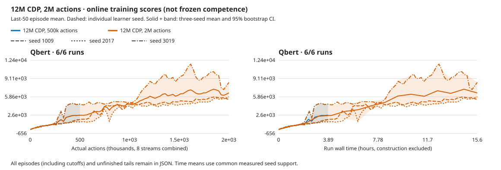

# More experience improves Qbert, but does not close the quality gap

**At 2M actions per learner, centered CDP reaches a frozen mean of 7,367.01,
versus 2,657.99 at 500k.** Every seed improves its score. First-pyramid
completions rise from 24/72 to 62/72, but seed 3019 falls from 24/24 to 20/24.
None meets the complete historical mastery gate or the 193,220.77 long-run
reference. All five quality targets and the RGB budget comparison remain open.

The [fixed allocation](../experiments/2026-10-09-cdp-qbert-budget.md) finishes
October 11 at **16:10:24 UTC**, after 46h44m25s including evaluation and audits.
All three train/evaluation pairs and independent seed reviews pass. A final
CPU completion/publication review passes in 52.02s, using 361.7 MiB and no swap,
without new GPU work, game actions or actor updates. No worker remains.

[Compact data](2026-10-11-cdp-qbert-budget.json) ·
[Full audit](../../runs/cdp-qbert-2m-20261009.992tJMEX/budget-review.json) ·
[Review script](../../runs/cdp-qbert-2m-20261009.992tJMEX/review_budget.py) ·
[Retained 500k result](2026-10-08-cdp-qbert-capacity.md).

## Scores, task completion and cost

Each frozen model uses the first three **natural** episodes from each of eight
streams, sampled policy and zero updates. Bootstrap intervals resample the
three learner seeds, not episodes; these intervals are coarse.

| Seed | Retained 500k frozen | 2M frozen | Actual initial | First pyramids, 500k → 2M | 2M online last 50 |
| --- | ---: | ---: | ---: | --- | ---: |
| 1009 | 1,790.63 | 5,172.92 | 175.00 | 0/24 → 20/24 | 5,376.50 |
| 2017 | 1,328.13 | 5,812.50 | 273.96 | 0/24 → 22/24 | 5,849.00 |
| 3019 | 4,855.21 | 11,115.63 | 153.13 | 24/24 → 20/24 | 8,411.00 |
| Mean / total | 2,657.99 | 7,367.01 | 200.69 | 24/72 → 62/72 | 6,545.50 |

Paired frozen gain is **+4,709.03 [3,382.29, 6,260.42]**. The new mean's
95% interval is [5,172.92, 11,115.63]. Only seed 2017 clears the historical
90% first-pyramid fraction; all three remain below its accompanying 15,000
mean-score threshold. A higher score is not the same as better task reliability.
Every actual-initial control completes zero pyramids.

The three fresh learners cost **6M actions, 23,991,010 emulator frames,
1,499,817 updates and 46h40m1s training**: 4.002× the retained 500k cohort's
11h39m35s. Each learner uses 2M actions / 499,939 updates and finishes with zero
training debt. Frozen evaluation adds **221,648 actions**, with zero updates.
Earlier controls, qualification, diagnostics and interrupted work are additional
costs, not included in this new allocation. These are fresh lifetimes, not
checkpoint resumes or video-pretrained actors.

Dashed traces retain all six learners; means and 95% bands weight learners
equally. The plot keeps every 50th common measured action point plus the final
point, and all common-time points. Full grids, episodes and unfinished tails
remain in the raw audit. Shorter controls are not extrapolated. These are
online training curves, not frozen competence curves.

## What changed, and what passed

Only the declared experience budget changes on the same 12M/T16 centered
CDP/action-effects recipe: N8/B8/H15/R32, replay 100000, microbatch 8,
cosine 500, encoder 6e-6/dynamics 4e-4/base 4e-5, warmup 1000, AGC .3,
ac_grads=false and exploration coefficient 1. Full 18 actions, sticky .25,
repeat 4, no reset no-ops, native input and one GPU RGB64 resize remain.
No action hint, detector, RAM input or externally shaped reward enters learning.

The runtime also has a [qualified backend refresh](2026-10-09-meganeura-refresh.md):
native 7311547d / Meganeura 31026833 / Blade 56f0565, versus retained native
83be73bf / f104f354 / e349cddf. Thus this is **not an exact same-binary budget
ablation**. The [exact recorded 500k prefix](2026-10-09-cdp-qbert-prefix.md)
supports early agreement for seed 1009 only; it is not universal parity,
pixel equality or final-500k tensor equality. Historical evidence is not repinned.

All **nine guards, 144 selected natural episodes, exact 346 saved tensors per
frozen model and six whole replays/videos pass**. Zero selected cutoffs or frozen
updates. All nine excess episodes, unfinished tails and ten standalone allocation
warnings remain. No learner retry, API/numerical/hard fault, separate NVML
polling or recovery occurred. GPU utilization remains unmeasured.

The completion review rereads training and frozen records, checks the pinned
recipe and update accounting, recomputes summaries/curves, verifies frozen
tensors and video hashes/frame counts/rates, and checks all independent seed
reviews. First-pyramid outcomes come from the exact selected replay episodes,
not positive-return counts. Evaluation seeds are reused development seeds,
not an untouched final test.

## Interpretation and next decision

More experience helps both previously weak seeds complete the first pyramid.
It does not establish stable mastery: all scores remain low against the long-run
target, and seed 3019 loses four selected first-pyramid successes while gaining
score. Keep that tradeoff rather than reporting only the improved mean.

At approximately 8M frames per learner, our online last-50 mean is **6,545.50**
versus **14,607.50** in the previously fixed published bin, using all six released
DreamerV3 seeds. This is a descriptive gap, not protocol-matched inferiority:
models, protocols and averaging windows differ. It also does not justify
claiming parity. The original last-10%-of-200M target is unchanged; see the
[retained source and bins](2026-10-09-cdp-five-game-capacity.json).

**Do not automatically extend the training budget across five games.** Next
inspect action-conditioned reward/terminal forecasts along the recorded Qbert
policy trajectories before choosing another learning change. The 12M prior
forecasts remain untested; low posterior reward loss is not forecast evidence.
Keep any diagnostic allocation bounded, actor-frozen and separate from these
completed cohorts. No new representation/capacity sweep or relaxed gate follows
from this result. Boxing, Pong, Freeway and Breakout retain their completed 500k
results; the full five-game quality and matched RGB budget questions stay open.

## Whole rollout videos

Whole stream-zero videos include excess episodes and unfinished tails; reported
scores cover all eight streams. These links require the local workspace.

| Seed | Trained | Actual initial |
| --- | --- | --- |
| 1009 | [Whole rollout](../../runs/cdp-qbert-2m-20261009.992tJMEX/qbert-centered-1009-candidate-frozen.mp4) | [Whole control](../../runs/cdp-qbert-2m-20261009.992tJMEX/qbert-centered-1009-untrained-frozen.mp4) |
| 2017 | [Whole rollout](../../runs/cdp-qbert-2m-20261009.992tJMEX/qbert-centered-2017-candidate-frozen.mp4) | [Whole control](../../runs/cdp-qbert-2m-20261009.992tJMEX/qbert-centered-2017-untrained-frozen.mp4) |
| 3019 | [Whole rollout](../../runs/cdp-qbert-2m-20261009.992tJMEX/qbert-centered-3019-candidate-frozen.mp4) | [Whole control](../../runs/cdp-qbert-2m-20261009.992tJMEX/qbert-centered-3019-untrained-frozen.mp4) |
